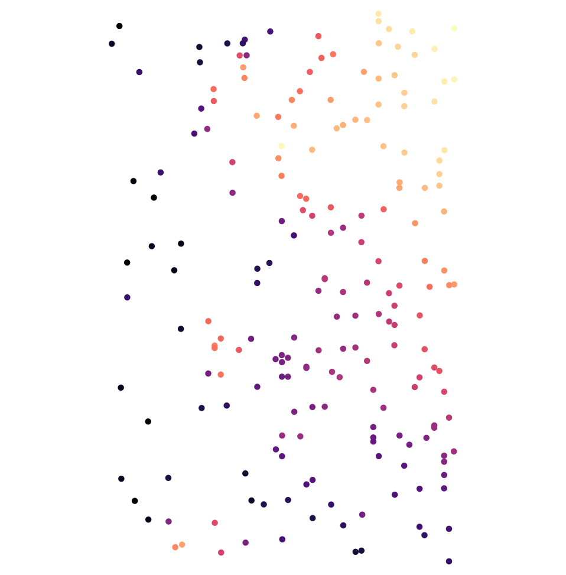
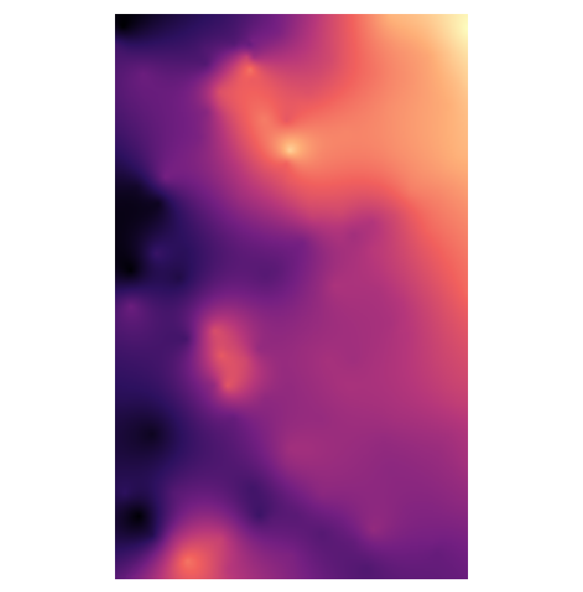

# Rust Interpolate

A learning project to implement geospatial interpolation using [ordinary kriging](https://gisgeography.com/kriging-interpolation-prediction/) in Rust.

Specifically my goals are:

- Read point observations from any GDAL-readable vector source (GeoPackage, Shapefile, FlatGeobuf, GeoJSON, CSV/XYZ text, …)
- Create a spatial index of the observations
- Create an empirical semivariogram from a sample of the input observations
- Create a mathematical model of the empirical semivariogram
- Estimate a raster grid covering the data extent
  - For every unknown point in the grid, use the model to predict the value and variance
- Write the predicted grid and the standard deviation grid as GeoTIFF rasters via GDAL

## Kriging

Kriging is a geostatistical technique for predicting the value of a spatial phenonmenon at an unobserved location. Kriging is a form of interpolation that takes into account the spatial relationship between the data and provides, along with an estimated value, the variance or uncertainty in the value.

_Principles of Geographical Information Systems_ by Burrough and McDonnel (1998) was my primary source of inspiration and the gory mathematical details, particularly Chapters 5 and 6.

## Build (reproducible, via Nix)

The project builds reproducibly with [Nix](https://nixos.org/) flakes and [crane](https://crane.dev/). All inputs are pinned — `nixpkgs`, `crane`, `flake-utils`, and the `gdal` crate commit — and both `Cargo.lock` and `flake.lock` are committed.

```
nix build            # build the release binary
nix run . -- --help  # run the CLI
nix develop          # dev shell with cargo, clippy, rustfmt, and GDAL tools
nix flake check      # run the test suite
```

The build links against the system GDAL from the pinned `nixpkgs`; no GDAL source is compiled.

## Usage

```
nix run . -- <input> [OPTIONS]
```

- `<input>` — any GDAL-readable point dataset.
  - `.gpkg`, `.shp`, `.fgb`, `.geojson`, … are opened by their native drivers.
  - Plain-text `.xyz` / `.txt` / `.tsv` / `.psv` / `.csv` files are read through the GDAL CSV driver (tab-separated for `.xyz`/`.txt`/`.tsv`, comma for `.csv`/`.psv`). Common X/Y/Z column names (`x`, `lon`, `longitude`, `field_1`, …) are mapped automatically.
- `--field <name>` — attribute field holding the observed value (default `z`). For 3D points or XYZ text, the geometry Z coordinate is used as a fallback.
- `--layer <name>` — vector layer name (defaults to the first layer).
- `-s, --samples`, `-n, --nbins`, `-m, --max-neighbors`, `-w, --target-width`, `-r, --range` — kriging parameters (see `--help`).
- `--prediction-grid`, `--stdev-grid` — output GeoTIFF paths (default `<input>.prediction.tif` / `<input>.stddev.tif`).

## Test

Input: `test.xyz`, a tab-delimited `X Y Z` text file with 200 points.



```
nix run . -- test.xyz
```

Outputs:

1. `test.prediction.tif` — predicted value grid (Float64 GeoTIFF)
2. `test.stddev.tif` — standard deviation grid (Float64 GeoTIFF)



```
➥ gdalinfo test.prediction.tif -mm
Driver: GTiff/GeoTIFF
Files: test.prediction.tif
Size is 256, 410
Origin = (-125.002956666700001,42.018268333300000)
Pixel Size = (0.001311588541797,-0.001311588541797)
Band 1 Block=256x4 Type=Float64, ColorInterp=Gray
    Computed Min/Max=-1124.534,-556.183
  NoData Value=-9999
```

## Maybe, someday?

This is a side project so I'm not likely to get around to this anytime soon. I welcome ideas and contributions though!

- [ ] Fit the model automatically, see [scipy](https://docs.scipy.org/doc/scipy/reference/generated/scipy.optimize.curve_fit.html#scipy-optimize-curve-fit)
- [ ] Support other models: Exponential, Linear, Gaussian, see [scikit-gstat](https://mmaelicke.github.io/scikit-gstat/reference/models.html)
- [ ] Cross-validation, MSPE on a subset of the original (removed prior to constructing empirical semivariogram)
- [ ] Python wrapper
- [ ] Refactor API and write more unit tests
- [ ] Other distance metrics: geodesic distance, great circle distance, ECEF 3D distance
- [ ] Co-kriging
- [ ] Trend elimination (ie Universal Kriging)
- [ ] Subsetting and combining overlapping variogram models
- [ ] Anisotropy
- [ ] Bayesian estimation

For a more complete implementation in Rust, check out the GeoStat framework's [GSTools-Core](https://github.com/GeoStat-Framework/GSTools-Core).
